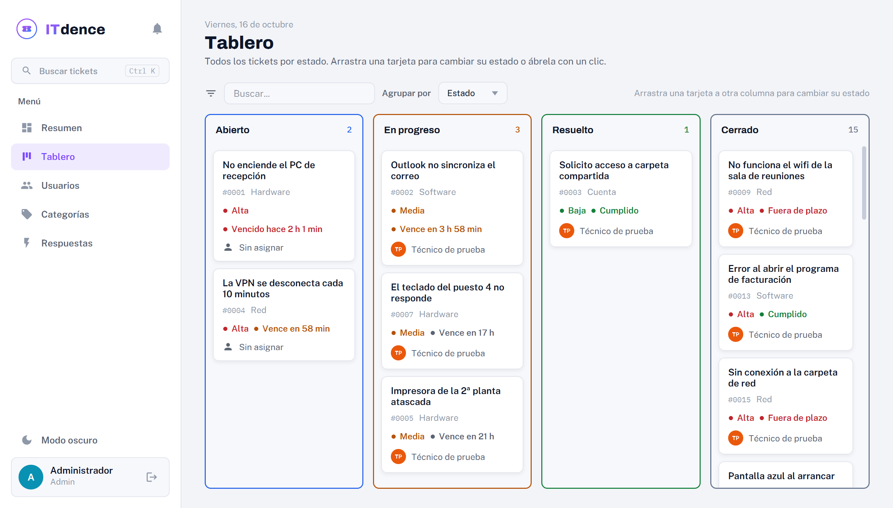
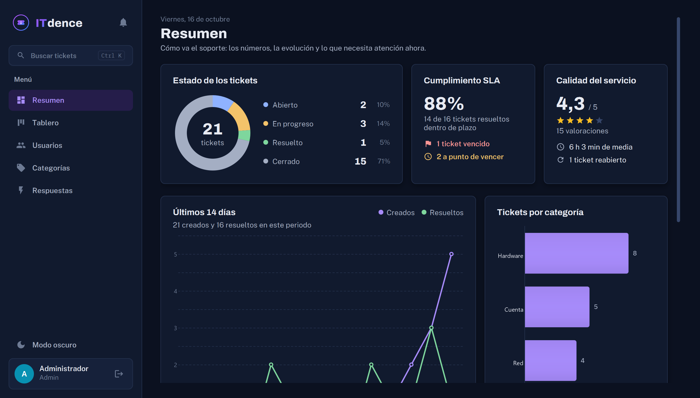

Aplicación de escritorio para gestionar incidencias IT (tickets) de una empresa. El nombre viene de "IT" + "incidence".

Proyecto Intermodular del ciclo de DAM (Línea 2: desarrollo de una aplicación).



## Qué hace

Hay tres roles:

- **Cliente**: abre tickets (título, descripción, categoría y prioridad), ve el estado de los suyos y habla con el técnico mediante comentarios. Puede **adjuntar capturas de pantalla**, **cancelar** un ticket propio y cambiar su nombre y contraseña desde **Mi perfil**. Cuando un ticket se resuelve decide si lo cierra (valorando la atención de 1 a 5 estrellas) o lo reabre con un motivo.
- **Técnico**: ve los tickets sin asignar y los suyos, con filtros y buscador. Puede tomar un ticket, cambiar su estado (abierto → en progreso → resuelto → cerrado), comentar, escribir **notas internas** que el cliente no ve y contestar con **respuestas rápidas**. También tiene un **tablero Kanban** donde arrastra las tarjetas entre columnas para cambiar el estado.
- **Administrador**: resumen con los tickets por estado, los **SLA vencidos** y el % de cumplimiento, tablero Kanban con todos los tickets, gráfico por categoría y gestión de usuarios, categorías y respuestas rápidas.

Todos los roles tienen una **campana de avisos** (sin necesidad de correo) y un **buscador global** con Ctrl+K. El admin también puede asignar tickets a un técnico y ve la calidad del servicio (valoración media, tiempo de resolución y reaperturas).

Cada ticket tiene un **plazo de resolución (SLA)** según su prioridad (alta 4 h, media 24 h, baja 72 h) y un **historial de actividad** con todo lo que ha pasado.

Las contraseñas se guardan hasheadas con BCrypt, nunca en texto plano.

La interfaz tiene modo claro y modo oscuro, animaciones y notificaciones.



## Tecnologías

- Java 21 (Eclipse Temurin)
- JavaFX 21.0.2
- SQLite (`sqlite-jdbc` 3.46.1.3) con JDBC, sin ORM
- BCrypt (`jbcrypt` 0.4)
- Maven, JUnit 5

No necesita internet ni un servidor de base de datos. La BD es un fichero (`data/itdence.db`) que se crea solo la primera vez que se arranca.

## Cómo ejecutarla

Hace falta el **JDK 21** y **Maven** (o IntelliJ, que ya trae Maven integrado).

```bash
git clone https://github.com/<usuario>/ITdence.git
cd ITdence
mvn javafx:run
```

Para pasar los tests:

```bash
mvn test
```

### Usuarios de prueba

Se crean automáticamente la primera vez que se arranca:

| Rol     | Email               | Contraseña |
|---------|---------------------|------------|
| Admin   | admin@itdence.com   | admin123   |
| Técnico | tecnico@itdence.com | tecnico123 |
| Cliente | cliente@itdence.com | cliente123 |

También se crean 5 tickets de ejemplo. Si quieres empezar de cero, cierra la app y borra `data/itdence.db`.

## Estructura

Arquitectura en 4 capas. Los controladores no tienen SQL: todo pasa por los servicios.

```
src/main/java/com/itdence
├── App.java              arranque de la aplicación
├── modelo/               Usuario, Categoria, Ticket, Comentario
├── dao/                  acceso a la BD con JDBC (ConexionBD + un DAO por tabla)
├── servicio/             lógica de negocio, validaciones y permisos
├── controlador/          pantallas JavaFX
└── util/                 PasswordUtil (BCrypt)
src/main/resources
├── schema.sql            creación de las tablas
└── styles.css            estilos de la interfaz
```

## Recursos de terceros

- Tipografías [Archivo](https://fonts.google.com/specimen/Archivo), [Public Sans](https://fonts.google.com/specimen/Public+Sans) e [IBM Plex Mono](https://fonts.google.com/specimen/IBM+Plex+Mono), con licencia SIL Open Font License.
- Trazados de los iconos de [Material Icons](https://fonts.google.com/icons), con licencia Apache 2.0.

## Documentación

- [Análisis de aplicaciones similares y funcionalidades](docs/analisis_funcional.md)
- [Diario de desarrollo](docs/diario_desarrollo.md)
- [Capturas](docs/capturas)
